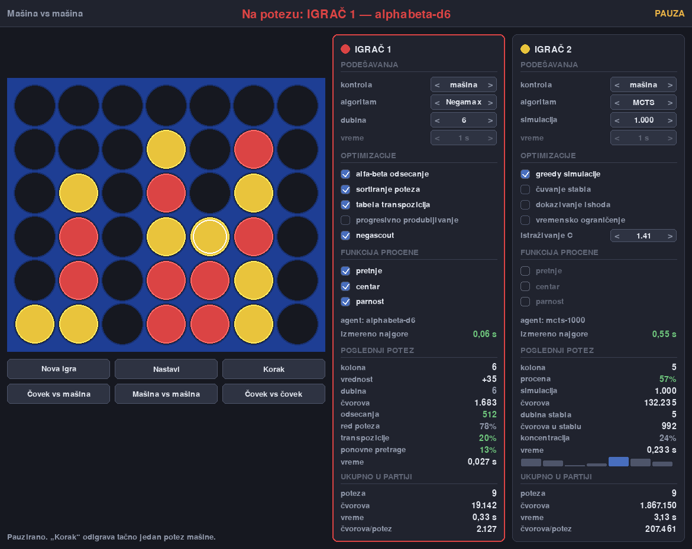
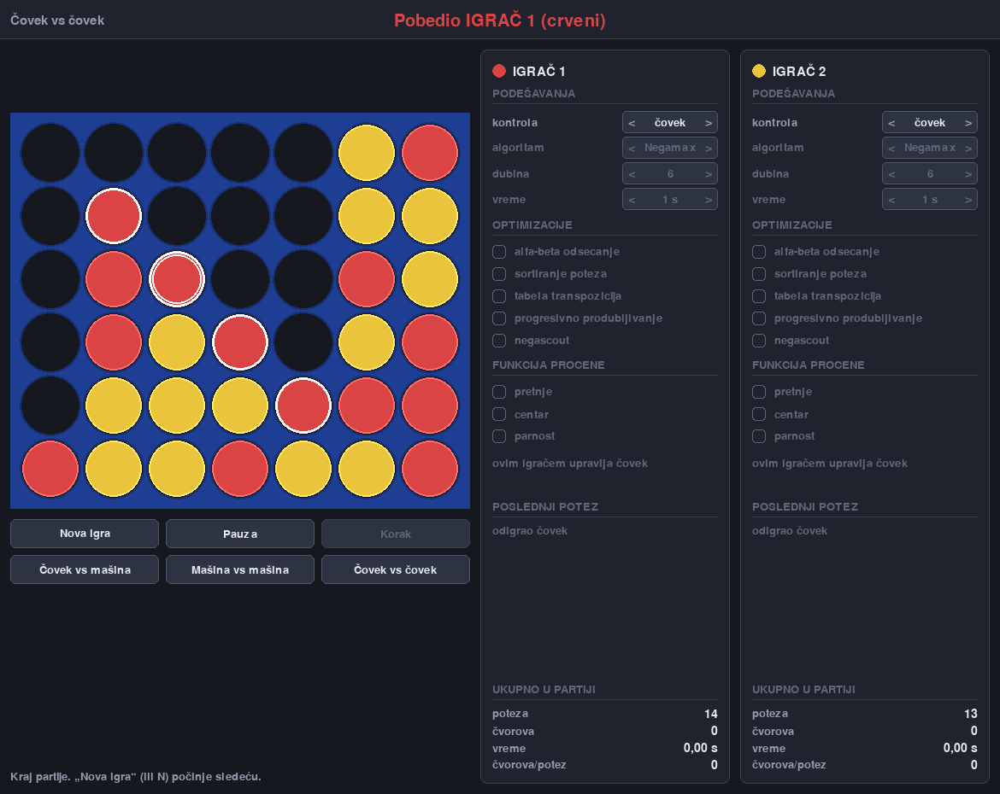

# Connect Four AI Simulator

[](https://github.com/Nikola-Vesovic/connect-four-ai-simulator/actions/workflows/tests.yml)

An interactive simulator and benchmarking framework developed for my bachelor's
thesis. Compare classical game-search agents, inspect their search statistics,
and measure how optimizations affect computation and playing strength.

The project combines **Minimax and Negamax, alpha-beta pruning, NegaScout, and
Monte Carlo Tree Search (MCTS/UCT)** with a bitboard engine, configurable search
budgets, parallel tournaments, and more than 500 automated tests.



An actual 18-move match: depth-6 Negamax with alpha-beta, move ordering, a
transposition table, and NegaScout versus MCTS with 1,000 greedy simulations.
Displayed timings are from this capture, not a controlled speed comparison.

## Features

- **Three play modes:** human vs. human, human vs. agent, and agent vs. agent.
- **Configurable agents:** Random, Greedy, Minimax, Negamax, and MCTS.
- **Search optimizations:** alpha-beta pruning, killer moves and history-based
  ordering, transposition tables, iterative deepening, and NegaScout.
- **MCTS variants:** random or greedy rollouts, tree reuse, outcome proof
  propagation, exploration settings, and simulation or time budgets.
- **Search instrumentation:** nodes, cutoffs, depth, table hits, re-searches,
  simulations, visit distributions, elapsed time, and game totals.
- **Experimental evaluation:** seeded matches, parallel round-robin tournaments,
  Elo estimates with bootstrap intervals, ablations, and exact-position checks.

Alpha-beta and NegaScout are options on the Negamax agent, not extra agent types
in the interface. At a completed fixed depth, value-preserving optimizations
must agree with the baseline Minimax value. MCTS is a separate algorithm; it
does not compute that value or use the same heuristic evaluation.

## Quick Start

Requires **Python 3.11+** and a desktop display. Development and local validation
use Python 3.13 on macOS; CI targets Python 3.11 and 3.13 on Linux.

```sh
git clone https://github.com/Nikola-Vesovic/connect-four-ai-simulator.git
cd connect-four-ai-simulator
```

On macOS or Linux:

```sh
python3 -m venv .venv
source .venv/bin/activate
python -m pip install -r requirements.txt
python main.py
```

On Windows PowerShell, with Python 3.13 installed:

```powershell
py -3.13 -m venv .venv
.\.venv\Scripts\python.exe -m pip install -r requirements.txt
.\.venv\Scripts\python.exe main.py
```

Windows commands are provided for convenience; Windows is not currently covered
by CI. The application has no command-line options: configure both players in
the window. Pygame runs the interface; Matplotlib and external benchmark inputs
are not needed to play.

### Interface

The original thesis interface is in **Serbian Latin script**. The source and
public documentation are in English. Common controls are:

| Interface label | Meaning |
| --- | --- |
| Covek / Masina | Human / Agent |
| Nova igra | New game |
| Pauza / Nastavi | Pause / Resume |
| Korak | Play one agent move while paused |
| Dubina / Vreme / Simulacija | Depth / Time / Simulations |

The table transliterates accented labels for quick reference. Click a column to
play; Space pauses, N starts a new game, Enter steps, and Escape closes the app.



Both screenshots come from the real renderer. Their configurations, legal move
sequences, and recorded statistics are in
[data/figures/screenshots.json](data/figures/screenshots.json). Regenerate them
with `python -m experiments.screenshots`; wall-clock timings will vary.

## Selected Results

These are stored thesis measurements, not promises about every position or
machine. Full tables and source CSVs are in
[data/figures/RESULTS.md](data/figures/RESULTS.md).

| Experiment | Recorded result |
| --- | --- |
| Empty board, depth 8 | Minimax: 6,634,026 nodes; alpha-beta: 11,830 |
| Seeded round-robin tournament | 7,500 games, 6 agents, 4,000-node budget |
| Parallel tournament on the development machine | 3.077x at 8 workers |

The first row is a **node-count comparison**, not a wall-clock speedup. The
empty board is particularly favorable to alpha-beta; the experiments also
include nonempty reference positions. Parallel speedup depends on hardware,
process overhead, and workload. Tournament ratings are relative to the tested
agents and budgets, not a universal playing-strength scale.

## Tests

For the complete suite, including benchmark validation and figure rendering:

```sh
python -m pip install -r requirements.txt -r requirements-figures.txt
python -m experiments.download_testsets
python -m pytest -ra
```

The download command obtains optional third-party inputs from their original
source and verifies SHA-256 checksums. Without those inputs, run the remaining
tests with `python -m pytest --ignore=tests/test_benchmark.py`.

Coverage includes differential checks between the naive and bitboard engines,
Minimax reference agreement, search budgets, MCTS properties, session behavior,
headless GUI rendering, tournament reproducibility, and benchmark data handling.
GUI tests skip without Pygame; rendering tests skip without Matplotlib. The
[CI workflow](.github/workflows/tests.yml) installs both to include those checks.

## Run an Experiment

Start with a short match or a small parallel tournament. These commands do not
overwrite the stored thesis results:

```sh
python -m experiments.match --a greedy --b random --games 100 --seed 2026
python -m experiments.runner --config data/configs/smoke.json --workers 2 --no-write
```

See the [experiment guide](docs/EXPERIMENTS.md) for reference verification,
configuration, full tournaments, perfect-solver benchmarks, ablations, and
figure generation.

## Architecture

| Module | Responsibility |
| --- | --- |
| [core/](core/) | Rules, naive board, bitboard, scores, position identity |
| [agents/](agents/) | Agent interface, search agents, bounded benchmark oracle |
| [search/](search/) | Evaluation, ordering, tables, budgets, search variants |
| [session.py](session.py) | Pygame-independent game state and player configuration |
| [game.py](game.py), [gui/](gui/) | Event loop, renderer, controls, search worker |
| [experiments/](experiments/) | Matches, parallel tournaments, benchmarks, plots |
| [tests/](tests/) | Unit, differential, integration, and regression tests |
| [data/](data/) | Configurations, stored results, reference values, figures |

The GUI delegates game decisions to `Session`. Agent search runs on a worker
thread so it does not block the event loop; tournament jobs use separate
processes. The benchmark harness is independent of Pygame.

## Scope and Limitations

- This is **classical AI search**, not a trained machine-learning model.
- Equal MCTS simulation counts do not imply equal work or equal time. Rollout
  policy and budget units must be stated when comparing agents.
- Fixed work budgets support reproducible comparisons; time-limited results
  depend on machine load. Parallel timed tournaments are deliberately rejected.
- The oracle is a bounded exact solver for benchmarking, not a guarantee that
  every opening can be solved within a practical Python search budget. Unsettled
  positions are reported rather than assigned a guessed exact value.
- Depth caps and displayed cost estimates come from measurements on the
  development machine. They are not universal response-time guarantees.

## Attribution and License

Author: **Nikola Vesovic**. The project was developed for a bachelor's thesis.
Historical phase references in code correspond to that development process.

This repository currently has **no open-source license**. Public availability
does not grant a general license to reuse or redistribute the original work.
Dependencies retain their own licenses.

Optional benchmark positions and scores are by **Pascal Pons**. They are
downloaded separately and excluded from the published Git history because no
explicit dataset redistribution license was established. See
[data/testsets/gamesolver/SOURCE.txt](data/testsets/gamesolver/SOURCE.txt) and
[the original benchmark protocol](http://blog.gamesolver.org/solving-connect-four/02-test-protocol/).
The separate C++ solver's AGPL license is not a license grant for this project
or those datasets.
